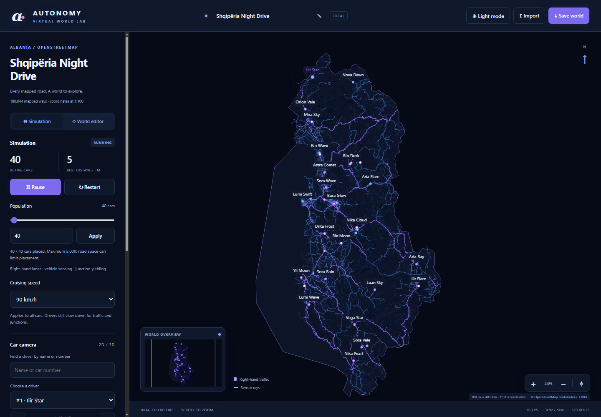
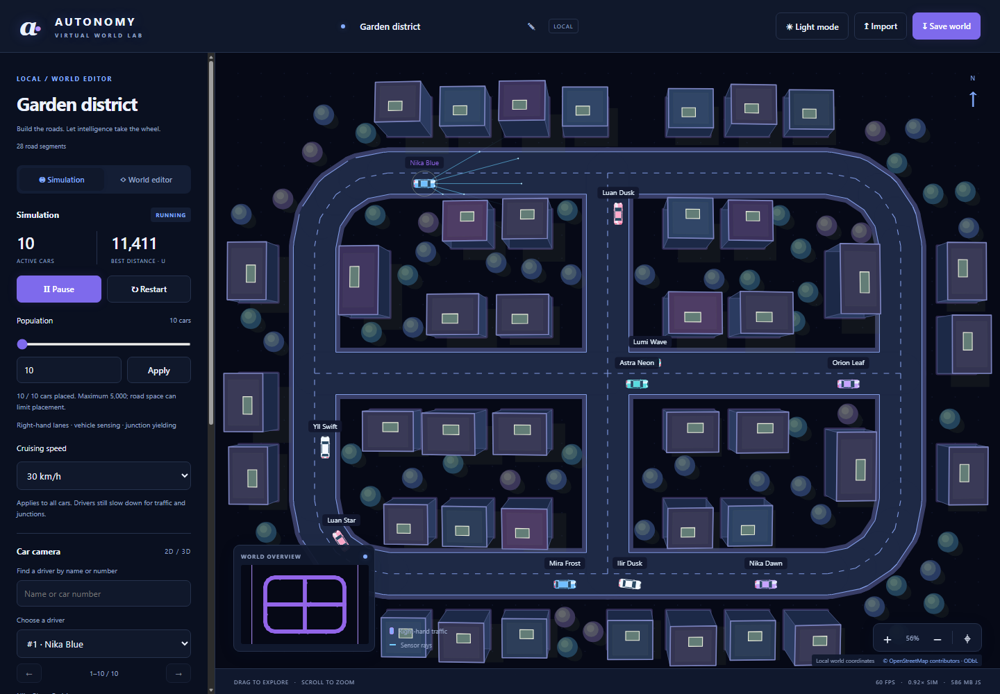
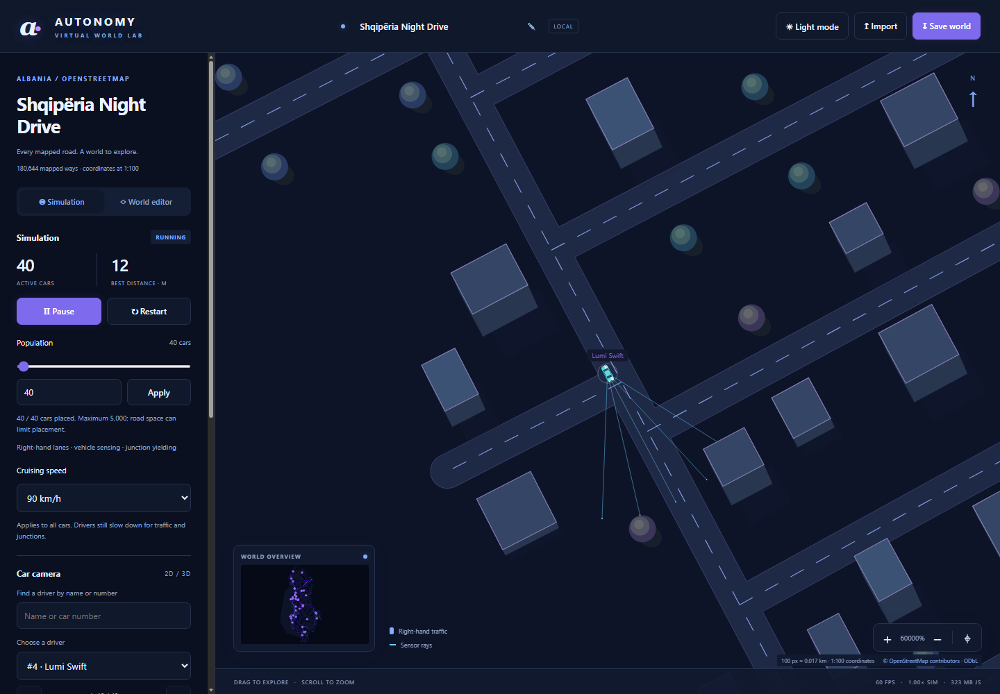

# Autonomy Virtual World

An open, browser based JavaScript simulation of self driving cars moving across an interactive virtual world. The default map uses a bundled OpenStreetMap road extract for Albania. Cars follow right hand lanes, sense nearby vehicles, brake for path conflicts, and can be watched from a following camera.

<p align="center">
  
  
  
  
  
  
  
</p>

## Screenshots

### Albania map and night theme



### Garden district: live traffic and sensor rays



### Split map and 3D car camera



## Features

- Explore Albania's roads or edit a small local world.
- Follow offset right hand lanes and one way directions.
- Use ray sensors and a small feed forward neural network for obstacle perception and advisory throttle control.
- Apply deterministic path based collision checks, braking distance, vehicle following, and junction reservations as a safety layer.
- Choose up to 5,000 cars, set cruising speeds through 300 km/h, and search drivers by name or number.
- Follow a selected car in 2D, 3D perspective, or split view; toggle car name tags.
- Switch between light and dark themes.
- Generate deterministic roadside buildings and trees near the camera.
- Save and import local worlds, names, markings, and editor changes.
- Run the larger fleets in a Web Worker so the page remains responsive.

## Run locally

Requirements: Node.js 18 or newer and a modern browser with Canvas 2D and Web Worker support. The application has no runtime npm dependencies and does not need a build step or API keys.

```sh
npm start
```

On PowerShell, use `npm.cmd start` if the shell's script policy blocks `npm.ps1`. Open [http://localhost:4173](http://localhost:4173). Keep the server running while using the app. The server serves local files and binds to `127.0.0.1:4173`.

The bundled Albania map is about 43.6 MB and loads from `data/albania-roads.js`. Use the local server instead of opening `index.html` directly, especially when running larger fleets, because browsers restrict workers on `file:` pages.

## Use the simulation

- **Pan and zoom:** drag the map and use the mouse wheel or zoom controls. The fit control returns to the world bounds.
- **Edit a local world:** choose **World editor** to place and connect road points or edit markings. In the Albania view, local roads are an additive editable overlay. Hold Alt or the middle mouse button to pan while editing; right click or Escape ends a road.
- **Set population:** use the slider or number field, then Apply. The supported range is 0–5,000 cars. Zero clears the fleet. Tight maps and start markings can limit how many cars fit.
- **Set speed:** choose a cruising target from 10 through 300 km/h. Cars still slow to follow a vehicle or yield at a junction.
- **Follow a car:** search by name or fleet number and select a driver. Choose 2D, 3D, or split camera mode. Use the tag control to show or hide names above cars.
- **Save a world:** edit the name in the top bar and choose Save world. The custom name is included in the downloaded `.world` filename and data. Import accepts compatible saved worlds and small OpenStreetMap JSON exports.
- **Read the performance display:** FPS is rendering rate; simulation rate compares simulated time to wall-clock time. The memory display uses a browser page estimate when available and labels its limited JavaScript heap fallback.

## Driving and simulation flow

1. `index.html` loads the dependency ordered classic scripts, the bundled road data, and `js/app.js`.
2. `CountryWorld` indexes the bundled OSM geometry for drawing. The local editor graph remains an overlay and does not replace source roads.
3. `buildTrafficNetwork()` converts eligible road ways into directed arcs, preserving one way restrictions. `makeLane()` offsets each direction to the right; cubic connector paths join lanes at intersections.
4. The simulator spawns cars on those lanes. At each fixed physics step, it builds a spatial index of cars, adjusts sensor range to speed and stopping distance, casts rays, checks the planned lane path for an actual footprint conflict, and computes a target speed.
5. A small 5–6–4 feed forward network responds to obstacle readings. Its starting weights are hand set; it is not pretrained or continuously trained. Deterministic braking and swept collision checks override unsafe outputs. Junction queues prevent conflicting cars from entering a crossing together.
6. At populations above 1,000, `fleet-worker.js` runs the same simulation in a Web Worker at 30 physics steps per second. Smaller fleets use the main thread at 60 steps per second. The renderer receives bounded snapshots and draws the map, cars, sensor rays, labels, and camera views.

The model uses a flat road graph and simplified lane geometry. It does not model elevation, road specific speed limits, traffic light control, or moving pedestrians. Stop, yield, and crossing markings may be displayed by the editor but do not create traffic signals or pedestrian agents.

## Architecture

```text
.
├── index.html                    Page structure and script dependency order
├── style.css                     Layout and light theme
├── themes.css                    Dark theme and theme variables
├── car.png                       Original tutorial car asset
├── package.json                  Local server command; no npm dependencies
├── tools/
│   └── serve.cjs                 Small Node.js static file server
├── data/
│   └── albania-roads.js          Bundled OSM derived road database
├── docs/
│   └── images/                   README screenshots
└── js/
    ├── app.js                    UI state, controls, frame loop, worker setup
    ├── constants/
    │   ├── simulation.js         Population, speed, timing and physics values
    │   ├── palette.js            Canvas theme colors
    │   └── vehicles.js           Shared vehicle visual profiles
    ├── brain/
    │   ├── network.js            Feed forward network and mutation
    │   ├── presets.js            Starter weights and brain validation
    │   └── sensor.js             Ray casting and route conflict sensing
    ├── objects/
    │   ├── car.js                Tutorial vehicle controls and rendering
    │   ├── vehicle-geometry.js  Collision footprint and overlap checks
    │   ├── vehicle-model.js      Detailed 2D and perspective car geometry
    │   ├── building.js           Procedural building objects
    │   └── tree.js               Procedural tree objects
    ├── simulation/
    │   ├── traffic.js            Lanes, dynamics, reservations and safety
    │   ├── fleet-worker.js       Large fleet worker and render snapshots
    │   └── controls.js            Tutorial input control types
    ├── world/
    │   ├── persistence.js        World save validation and OSM JSON import
    │   ├── generation/
    │   │   ├── math/             Geometry helpers, graph and spatial grids
    │   │   ├── primitives/       Points, segments, polygons and envelopes
    │   │   ├── traffic-network.js Directed arcs, offset lanes and connectors
    │   │   ├── country.js        Albania world and OSM road drawing
    │   │   ├── world.js          Local world and road boundary generation
    │   │   ├── demo.js           Garden district demo graph
    │   │   └── scenery.js        Roadside building and tree placement
    │   └── editor/
    │       ├── controller.js     Pointer/keyboard interaction and editing
    │       └── markings/         Start, parking, stop, yield and target marks
    ├── rendering/
    │   ├── scene.js              2D map, cars, labels and overview
    │   └── chase.js              Perspective 3D chase view
    └── ui/
        └── metrics.js            FPS, simulation rate and memory display
```

These modules are loaded as classic scripts in `index.html` and share the page's global scope. The worker repeats its own imports in `js/simulation/fleet-worker.js`; add new shared runtime modules to both import lists where needed. The project uses no front end framework, rendering library, mapping SDK, or physics engine.

## Map data and attribution

The included `data/albania-roads.js` is derived from Geofabrik's Albania OpenStreetMap extract and boundary file, downloaded on 2026-10-07. Its embedded metadata records the source checksum, projection, scale, and simplification tolerance. It contains 180,644 highway ways and 1,248,563 retained coordinate nodes; 125,267 motor eligible ways are used for traffic. One world unit represents approximately 100 metres. The extract boundary includes a coastal buffer and is not a surveyed coastline.

The map data is separate from the MIT licensed application code. It is made available under the Open Database License (ODbL). Map attribution in the app reads **© OpenStreetMap contributors · ODbL** and links to the copyright and license information.

- [Geofabrik Albania extract and download files](https://download.geofabrik.de/europe/albania.html)
- [OpenStreetMap copyright, attribution, and licensing](https://www.openstreetmap.org/copyright)
- [Open Database License 1.0 text](https://opendatacommons.org/licenses/odbl/1-0/)
- [OpenStreetMap attribution guidance](https://wiki.openstreetmap.org/wiki/Community_attribution_advice)

This stock runtime repository includes the derived road bundle, not the original PBF, boundary file, or converter script. No map tiles or live data are fetched at runtime.

## Original projects and references

This project adapts concepts and assets from Radu Mariescu-Istodor's library free JavaScript tutorials. The source projects are useful references for the original driving, road, sensor, collision, traffic, and neural network stages:

- [Virtual world tutorial repository](https://github.com/gniziemazity/virtual-world)
- [Self driving car tutorial repository](https://github.com/gniziemazity/Self-driving-car)
- [Artificial sensors source](https://github.com/gniziemazity/Self-driving-car/tree/main/3.%20Artificial%20sensors)
- [Collision detection source](https://github.com/gniziemazity/Self-driving-car/tree/main/4.%20Collision%20detection)
- [Traffic simulation source](https://github.com/gniziemazity/Self-driving-car/tree/main/5.%20Traffic%20simulation)
- [Neural network source](https://github.com/gniziemazity/Self-driving-car/tree/main/8.%20Optimizing%20neural%20networks)
- [Virtual world and cars tutorial video](https://www.youtube.com/watch?v=5iHejdqYIa8)

The original code and car image retain their MIT license and copyright notice in [`LICENSE`](LICENSE). OpenStreetMap derived data remains under its separate ODbL terms. Procedural buildings and trees are generated by this project; they are not mapped OSM footprints or surveyed vegetation.

## License

Application source and the original tutorial asset are provided under the MIT License; see [`LICENSE`](LICENSE). The bundled OpenStreetMap derived database has the separate ODbL license and attribution described above.
